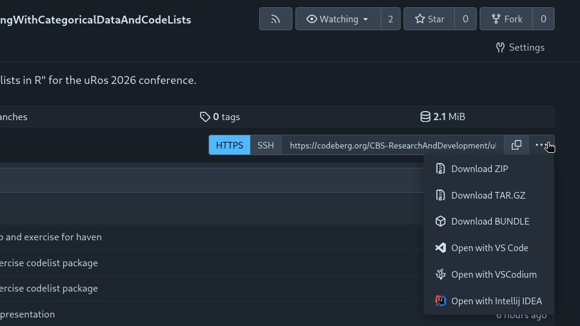

# uRos-2026-Workshop-WorkingWithCategoricalDataAndCodeLists

Materials for the workshop "Working with categorical data and code lists in R" for the uRos 2026 conference. Topics treated during the workshop:

- Categorical variables and code lists.
- `factor`/base-R.
- `labelled`  from the `haven` package.
- `forecats` package
- `codelist` package

### Preparation for the workshop

Make sure the following packages are installed:

- `haven`
- `forecats`
- `codelist`

These can be installed from R using

```R
install.packages(c("haven", "forecats", "codelist"))
```

Also make sure the materials in this repository are available on your machine during
the workshop. We will use these during the demonstrations and exercises. 

When you have `git` on your machine you can clone the repository: 

```bash
git clone https://codeberg.org/CBS-ResearchAndDevelopment/uRos-2026-Workshop-WorkingWithCategoricalDataAndCodeLists.git
```

Otherwise, in codeberg on this page, you can click on the three dots above the 
file list and select download as zip. 

{width: 50%}

### Overview of the repository


`presentations/working_with_categorical_data.pdf`
: The presentation used in the workshop. Although, most of the main content is shown during interactive demonstrations. 

`demo`
: The scripts for the demonstrations given during the workshop. Note that we will deviate from these scripts based on questions during the workshop.

`exercises/`
: The exercises to be made during the workshop. Make sure these are on your machine during the workshop. 

`data/`
: Example files used during the demonstrations an exercises. Make sure these are on your machine during the workshop. 

